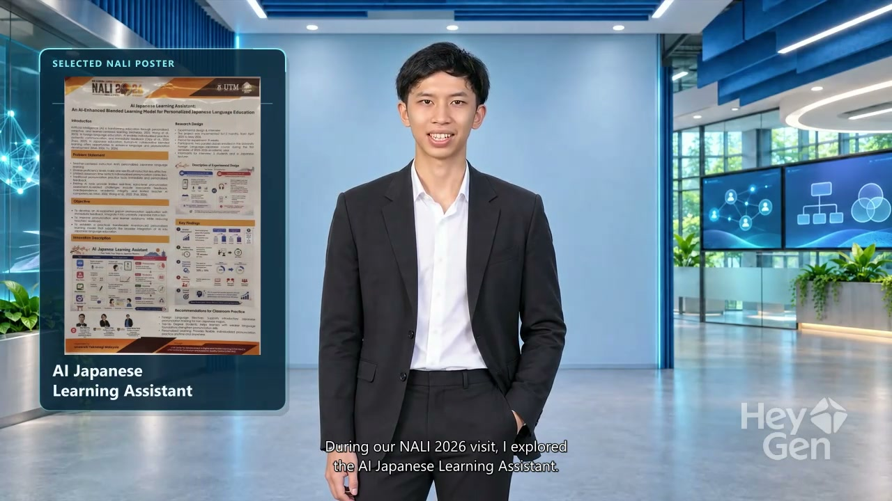
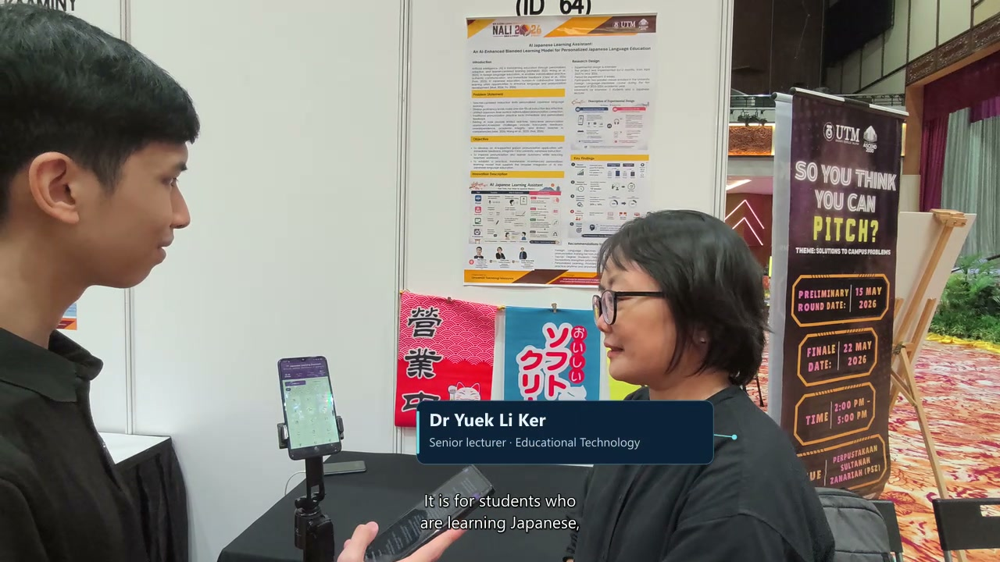

# Assignment 1 — AI Video on NALI 2026

**Wong Wen Hao · SECP1513 Technology and Information System · Universiti Teknologi Malaysia**

## Final video

**[Open the Group 3 video folder on Google Drive](https://drive.google.com/drive/folders/1PITcJZEaX9cXr2FnsT1wx4SGjZMSC09V?usp=drive_link)**

| Detail | Information |
| --- | --- |
| Activity | Visit to New Academia Learning Innovation (NALI 2026) |
| Event dates | 28–29 October 2026 |
| Theme | Human–AI Synergy in Pedagogy |
| Group | Group 3 - AG, six members |
| Deliverable | Edited group video with interviews and personal reflections |
| Final video | 33 minutes 5 seconds, 1280 × 720, MP4 |
| My selected poster | AI Japanese Learning Assistant |

The Google Drive folder above is the video-sharing destination. This repository contains the project explanation, reflection and selected visual evidence. It does not contain the approximately 1 GB video or the raw recordings.

## The task

Our group explored six selected innovations related to ICT in teaching and learning. The assignment combines a NALI introduction using an AI avatar, poster explanations, recorded interviews, individual reflections and an overall conclusion.

The video brings these activities together so a viewer can understand both the projects and what we learned from meeting their teams.

## My contribution

I focused on the **AI Japanese Learning Assistant**, interviewing Dr Yuek Li Ker and Dr Chee Beng Yang about the learning problem, project objectives, future development, the relationship between AI and human empathy, and data privacy.

I prepared my avatar introduction and personal reflection with AI assistance, selected the poster evidence, and reviewed how the interview answers relate to TIS. I also worked on the group video's organisation and review, including the order of member sections, interview labels, subtitles, transitions and the closing screen. AI tools assisted the scripts, editing and technical checks; this is not presented as entirely manual production.

## What my selected project shows

The poster presents an AI-enhanced approach to Japanese learning through pronunciation practice, vocabulary, grammar support and conversation. The interview helped me distinguish the current development stage from longer-term plans.

The central learning problem is practical: students have different abilities, while lecturers have limited time for individual feedback. Immediate AI feedback may help students practise independently, but its accuracy and educational usefulness still need checking. Personalisation also does not automatically mean that a system understands a learner's feelings or motivation.

Local AI infrastructure was discussed as a possible future approach to handling sensitive data. It should not be described as an existing, verified privacy feature of the demonstrated application.

[View the selected poster photograph](poster-preview.jpg) · [Read my detailed reflection](REFLECTION.md)

## Video chapter guide

The times below refer to the final group export shared through the linked Google Drive folder.

| Start | Section |
| --- | --- |
| 00:00 | Opening and NALI 2026 introduction |
| 00:35 | Wong Wen Hao — AI Japanese Learning Assistant |
| 06:17 | Chong Zi Jian — ElektroTutor AI |
| 11:21 | Abdullah Faiyaz Rawoot — CinePrompt AI |
| 15:59 | Muhammad Aqil — ErgoCheck AI |
| 22:13 | Ahmed Khalid Ahmed — educational AI and physics-informed neural networks |
| 30:04 | Mouaamn Alali — MYFresh Logistics Crisis |
| 32:51 | Group takeaway and closing credits |

## Learning and evidence

| Learning focus | Evidence and application |
| --- | --- |
| Information systems in practice | Connected learner input, network access, AI processing and feedback to the learning experience |
| Responsible AI | Considered feedback accuracy, teacher review, costs and the handling of student data |
| Technical communication | Combined a poster, recorded answers and supporting figures in a structured video |
| Review and collaboration | Organised the supplied member contributions and checked speaker labels against clarified identities |

These are my learning connections, rather than a claim that specific official course outcomes have been formally assessed.

## Supporting files

- [Personal reflection](REFLECTION.md)
- [Sources, credits and AI assistance](SOURCES.md)
- [English subtitles](NALI-2026-English-Subtitles.srt)
- [LinkedIn learning-post draft](LINKEDIN-DRAFT.md)

The subtitles are an ASR-assisted editing source with technical corrections. They still need a final listening proofread. Some captions in the previously completed teammate segment are already embedded in that video and are not duplicated in the SRT.

## Group credit

Wong Wen Hao, Chong Zi Jian, Abdullah Faiyaz Rawoot, Muhammad Aqil, Ahmed Khalid Ahmed and Mouaamn Alali contributed to the group submission. This portfolio's written reflection concerns my own selected project and production experience; it does not replace my teammates' personal reflections.

## Submission and professional sharing

The Google Drive folder link is provided above. Confirm that the lecturer can open the folder and video without requesting permission. The assignment brief requires each member to submit a PDF containing the video link through UTM E-learning, followed by GitHub submission one week after the E-learning submission.

The ePortfolio slides also require a LinkedIn report with work evidence and reflection. The included post is a draft, not a published LinkedIn post. This GitHub entry does not itself submit anything to E-learning or LinkedIn.

[Back to the course portfolio](../README.md)
