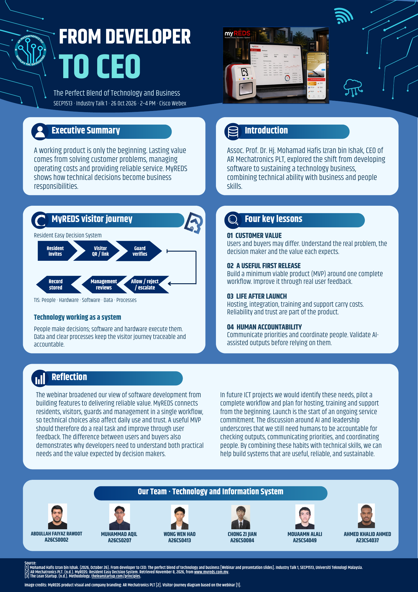

# Assignment 2 — Industry Talk 1

## From Developer to CEO: The Perfect Blend of Technology and Business

| Detail | Information |
| --- | --- |
| Course | SECP1513 — Technology and Information System |
| Institution | Universiti Teknologi Malaysia |
| Speaker | Assoc. Prof. Dr. Hj. Mohamad Hafis Izran bin Ishak |
| Role | CEO, AR Mechatronics PLT |
| Webinar | 26 October 2026, 2:00–4:00 PM, Cisco Webex |
| Deliverable | One A4 group poster |

## Final evidence

**[View or download the final poster](TIS-Assignment-2-Final-Poster.pdf)**

The poster includes an executive summary, speaker introduction, MyREDS visitor workflow, four lessons, a group reflection, team details and references.

## What the talk explains

- **Customer value:** the people using a system and the people deciding to buy it may have different needs.
- **A useful first release:** an MVP should support a complete task and improve through real user feedback.
- **Responsibilities after launch:** hosting, integration, training and support affect both reliability and operating costs.
- **Human accountability:** technical skills need clear communication, coordination and review of AI-assisted output.

MyREDS makes these relationships concrete: residents create invitations, visitors receive QR access details, guards verify entry, and management uses the records. The example connects the TIS elements of people, hardware, software, data and processes.

## My preparation and review focus

My work on the portfolio preparation centred on organising the poster content, reviewing its visual hierarchy and wording, checking the assignment instructions, and improving source attribution. These activities are distinct from the contributions made by other group members, which are not individually assigned here.

The poster was developed through several layout and wording revisions. AI tools assisted with design drafts, logo colour adaptations and editorial review; the supplied final poster records the group's selected result.

## Learning record

[Read the detailed reflection](REFLECTION.md), including challenges, skills developed and improvements for a future project.

| Learning outcome | Evidence in this assignment |
| --- | --- |
| Explain an information system | MyREDS workflow and the five TIS components |
| Relate technology to business | Customer value, MVP feedback and ongoing service costs |
| Communicate technical ideas | A single-page visual summary with a labelled workflow |
| Use sources responsibly | References and specific credit for the official product visual |

## Group credit

The final poster credits Abdullah Faiyaz Rawoot, Muhammad Aqil, Wong Wen Hao, Chong Zi Jian, Mouaamn Alali and Ahmed Khalid Ahmed. Names are reproduced from the supplied poster.

## Sources and professional sharing

[References and image credits](SOURCES.md) · [LinkedIn learning-post draft](LINKEDIN-DRAFT.md) · [Back to the course portfolio](../README.md)
